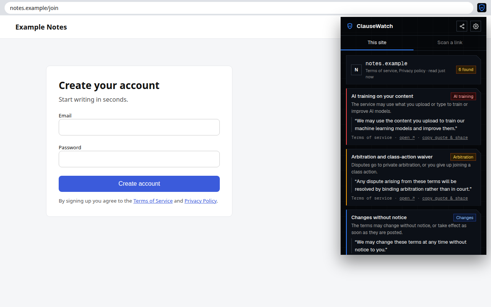

# ClauseWatch

ClauseWatch is GuardianVigil's open-source browser extension for reading terms of service and privacy policies. It shows exact source quotes about topics such as data sale, automatic renewal and arbitration. A topic label is not a legal interpretation, and “not found” does not mean “safe”.

- Reads documents on your device, with no account or telemetry.
- Supports downloaded HTML, rendered policy tabs, pasted or selected text, and text-based PDFs.
- Keeps link scans running after the popup closes, with progress, cancellation and retry.
- Offers optional AI help, local policy comparisons, report exports and previewed diagnostics.

By [GuardianVigil](https://guardianvigil.io/clausewatch). Apache License 2.0.

**Documentation scope:** these pages describe the current source checkout. Changes listed under [Unreleased](CHANGELOG.md#unreleased) are not a published release. The package version is `1.0.0`; the source bundles English rules version 4 and Spanish/French packs version 1. Check the [release notes](https://github.com/GuardianVigil-Labs/ClauseWatch/releases) for a particular published build.



The screenshots illustrate the earlier interface and do not show every control in the current source.

## Build and load

Use Node.js 24 and npm. Run from the repository root:

```sh
npm ci
npm run build
npm run build:firefox
```

| Browser | Build directory | Load from source |
|---|---|---|
| Chrome, Edge, Opera, Brave, Vivaldi | `.output/chrome-mv3` | Open the browser's extension manager, enable developer mode and choose **Load unpacked**. |
| Firefox | `.output/firefox-mv3` | Open `about:debugging#/runtime/this-firefox`, choose **Load Temporary Add-on**, then select `manifest.json`. |

The manifest requires Chrome 137 or later, Firefox 140 or later, and Firefox Android 142 or later. Store installation, temporary-add-on behaviour and built-in model availability depend on the browser. Go is needed for contributor rule checks, not for building the extension. See [development](docs/development.md).

## Read a policy

1. Open a service's page and click ClauseWatch.
2. In **This site**, choose the policies to read and grant the requested site access. Known services use the addresses in `rules/sites.json`.
3. Review each quote, its source, coverage notices and **Show surrounding text**.

For a direct address or pasted policy, use **Scan a link**. **Open persistent scan screen** opens the same controls in a browser tab. Background scan payloads expire ten minutes after creation; **Latest report** separately retains the last displayed web-policy quote report for seven days. **Check again** starts a fresh scan with the necessary permission.

For JavaScript-loaded, protected or sign-in-dependent policies, open the policy yourself, wait for it to load, then open ClauseWatch on that tab and choose **Read visible policy**. Manual document selection can bypass an unrecognised title; it does not verify that the policy is complete. The extension does not sign in or activate page controls for you.

Text-based PDF extraction runs locally. External policy links are fetched only after selection and host permission. **Highlight quote in policy** uses browser text-fragment support; copy and search the quote when highlighting is unavailable.

## Coverage and limits

| Area | Current behaviour |
|---|---|
| English | 19 bundled rules under 13 topics; newer verified signed English releases can replace them. |
| Spanish and French | Three rules per bundled language pack: data sale, automatic renewal and arbitration. Other topics are not presented as checked. |
| Other or uncertain languages | Coverage is labelled. Other languages are checked with the English rules only; uncertain text, or a language known only from the page's markup, uses the English rules (with the Spanish or French pack where it applies) and a notice. |
| Downloads | At most 2 MiB per request, a 20-second deadline and checked redirects. Sites requiring browser execution or authentication need the tab fallback. |
| PDFs | Text-based policies only: at most 100 pages, 200,000 extracted characters and 15 seconds of extraction. No OCR. |
| Source verification | Quotes and nearby context are retained. Matching is bounded pattern detection, not complete legal interpretation. |

See the [user guide](docs/user-guide.md) for complete workflows and limitations.

## Optional features and privacy

Automatic mode starts only after setup or Settings enables it and the browser grants site access. It recognises form structure without reading field values. Disabling it stops already-injected scripts and automatic reads. Failed policies remain retryable; only a complete terms-and-privacy read quiets the site for a week.

AI help is off by default. A built-in model processes policy text on the device. With your own API key, the selected service receives the text you ask about. Long documents use visible batches of at most 24,000 source characters. AI findings must preserve complete source units; summaries select source sentences rather than generate new claims. Requests have cancellation, retry and a 90-second deadline. Changing the endpoint or path requires an explicit credential choice.

Policy comparisons are also off by default. Enabling and remembering a version stores bounded policy text locally for exact paragraph comparisons. Report exports deliberately include source URLs and quotes; diagnostic previews exclude them. Neither is uploaded automatically.

ClauseWatch downloads policies from their hosts and signed rule updates from GitHub. It has no telemetry service. Full storage limits, network behaviour and export details are in the [privacy policy](docs/PRIVACY.md).

## Documentation

| Audience | Start here |
|---|---|
| Users | [User guide](docs/user-guide.md), [privacy](docs/PRIVACY.md), [rules and coverage](docs/rules.md) |
| Developers | [Development](docs/development.md), [architecture](docs/architecture.md), [reader contract](docs/reader.md), [rule fixtures](rules/README.md) |
| Contributors | [Contributing](CONTRIBUTING.md), [repository policy](POLICY.md), [security reporting](SECURITY.md) |
| Maintainers | [Release guide](docs/releasing.md), [browser checklist](docs/browser-checklist.md), [store listing](docs/STORE_LISTING.md) |

The documentation site is built from `docs/`. Product changes are recorded in [CHANGELOG.md](CHANGELOG.md).

## Contributing

Use invented policy text and example domains in tests. Every rule change needs positive and negative fixtures that agree in JavaScript and Go. Every change reaches `main` through a code-owner-reviewed pull request. Do not include private information, machine identifiers, credentials, unrelated projects or internal planning in a public contribution.

Build and validation instructions are in [development](docs/development.md). Questions: open a project issue or contact clausewatch@guardianvigil.io. Report security issues privately using [SECURITY.md](SECURITY.md).

## Licence

Copyright 2026 GuardianVigil. [Apache License 2.0](LICENSE); third-party notices are in [NOTICE](NOTICE). The bundled Geist fonts use the SIL Open Font License. ClauseWatch and GuardianVigil names and the shield mark are covered by [TRADEMARKS.md](TRADEMARKS.md), not the code licence.
