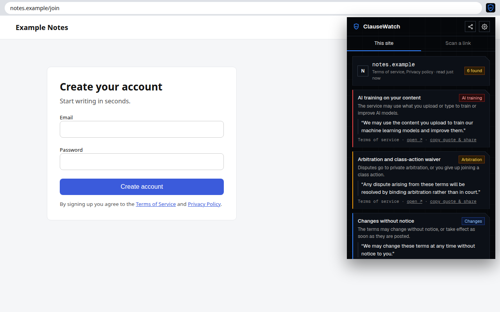
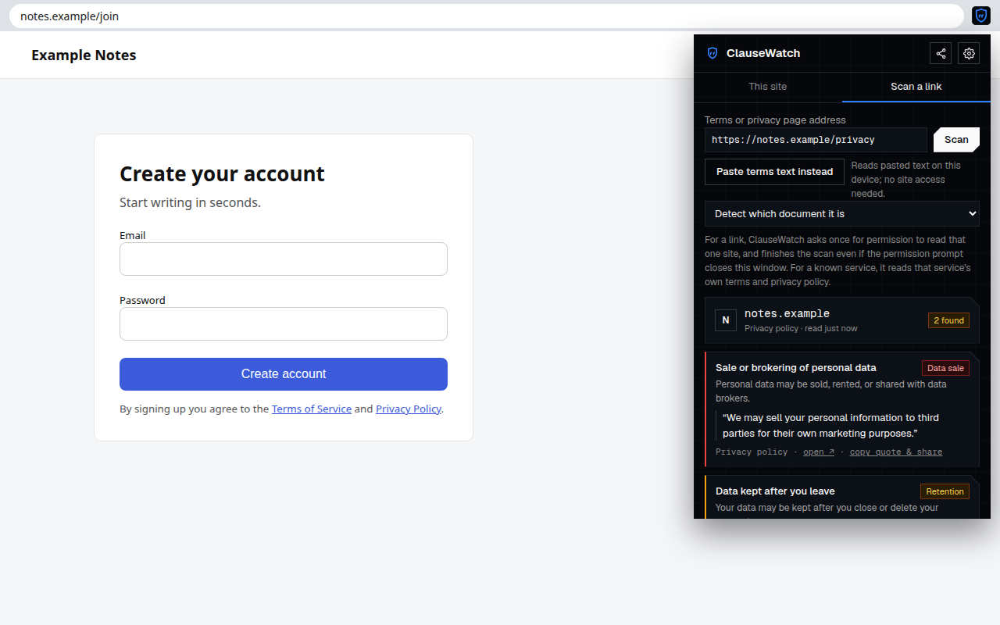
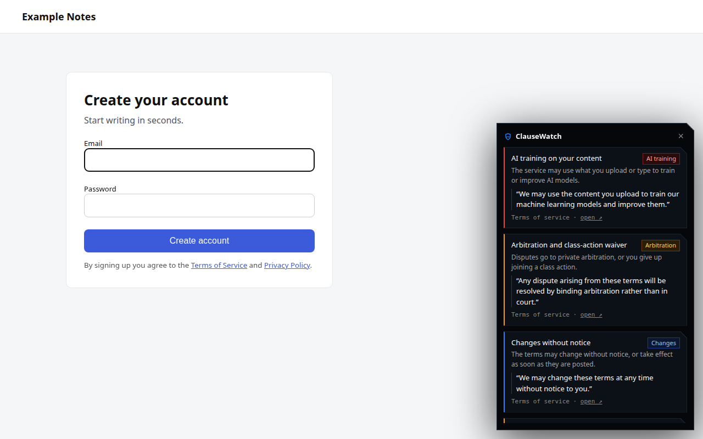
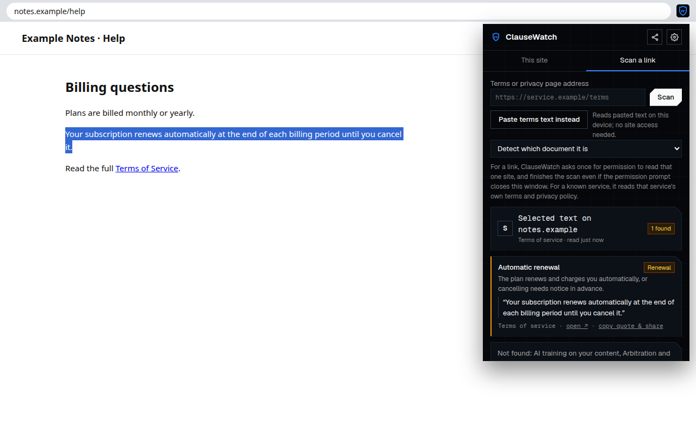
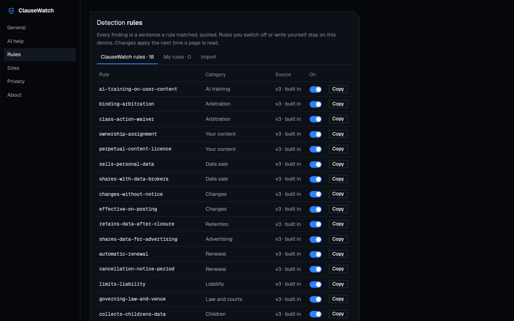

# ClauseWatch

A free, open-source browser extension that shows what a service's terms of service and privacy policy say, quoted from the documents themselves, at the moment you sign up.

- **On your device:** no account, no tracking, no telemetry. It works offline with the rules it ships with.
- **Quote or nothing:** every finding is an exact sentence from the document. "Not found" and "could not read" are shown as such, never as "safe". Quotes from the documents, not legal advice.
- **Open rules:** the detection rules and the list of known sites live in this repository, improved by pull request. The GuardianVigil team signs each rules release, and the extension accepts only releases signed with the key built into it.

Version 1.0.0. By GuardianVigil: https://guardianvigil.io/clausewatch



## Install

Store links will be added here: Chrome Web Store, Microsoft Edge Add-ons, Firefox Add-ons and Opera add-ons (Brave and Vivaldi install from the Chrome Web Store).

To build from source (Node.js 24):

```sh
npm ci
npm run build            # Chrome, Edge, Opera, Brave, Vivaldi: .output/chrome-mv3
npm run build:firefox    # Firefox: .output/firefox-mv3
```

Then load it unpacked: in Chrome, `chrome://extensions` → **Developer mode** → **Load unpacked** → `.output/chrome-mv3`; in Firefox, `about:debugging#/runtime/this-firefox` → **Load Temporary Add-on…** → `.output/firefox-mv3/manifest.json`.

## Screenshots

| | |
|---|---|
|  |  |
|  |  |

## Privacy

Nothing about you leaves your device. ClauseWatch makes one request of its own: a daily download of the signed rules release from this repository's GitHub releases, with no account, identifier or cookie. If you turn on AI help with your own API key, the text you ask about goes to the AI service you chose. No account, no tracking, no telemetry, no advertising. The full policy: [docs/PRIVACY.md](docs/PRIVACY.md).

## Documentation

- [User guide](docs/user-guide.md): setup, reading a site, known sites, the right-click menu, the card, AI help, rules, data requests.
- [Detection rules and known sites](docs/rules.md), [the rule list](rules/README.md) and [the reader contract](docs/reader.md).
- [Architecture](docs/architecture.md): entry points, the engine, rules updates, permissions.
- [Privacy](docs/PRIVACY.md), [security reports](SECURITY.md), [changelog](CHANGELOG.md), [code of conduct](CODE_OF_CONDUCT.md).
- For maintainers: [releasing](docs/releasing.md), [the real-browser checklist](docs/browser-checklist.md), [store listing](docs/STORE_LISTING.md), [maintainer guide](AGENTS.md).

The documentation is also published as a site from `docs/` with GitHub Pages.

## How it works

- **This site.** Click the toolbar button. ClauseWatch reads the page you are on (it holds no site access until you click), finds its terms and privacy links, and on your say-so asks for that one site, reads the documents on your device and gives the access back.
- **Known sites.** For about 45 popular AI and software services, `rules/sites.json` names the exact terms and privacy addresses, so ClauseWatch reads them even where the page has no link to them, and in automatic mode shows its card as soon as a known sign-up page opens.
- **Scan a link.** Paste a terms or privacy address (or any address on a known service), or paste the text itself, read on the device. When the browser closes the popup for the permission prompt, the scan finishes in the background, ready when you open the popup again.
- **Right-click.** **ClauseWatch: check this terms link** reads a linked document; **ClauseWatch: check selected text** quotes what the rules find in the clause you selected.
- **Automatic mode** (off until you choose it in setup or Settings, which asks for site access at that moment): a sign-up or consent form is recognised by its fields (an email field with a new password, or an "I agree" checkbox), never by what is typed, and a card shows the quotes when you start filling it in. The page is never blocked. Documents are fetched only from the page's own site or its known-site addresses, and their quotes remembered for a week, without the full text. **Don't show on this site** quiets a site (Settings → Sites); a site shown in the last week stays quiet, with a dot on the icon.
- **Rules updates.** Once a day the extension downloads the latest signed `rules.signed.json` from this repository's GitHub releases, and uses it only if it verifies against a key built into the extension and is newer than what it has. That download is the only request ClauseWatch makes on its own.

Under a report, **Ask them to delete my data** drafts a GDPR or CCPA letter on the device, suggests the privacy address the policy names, and opens it in your own email (or copies it). The popup's **Share** menu shares a plain link to the ClauseWatch page, with no tracking code, and **Copy quote & share** copies a finding with its source. In the popup, **Recently checked** notes for 30 days when a document's text changed since the check before (compared on this device).

## AI help (optional)

Off by default. The rules always run first; AI can then look for clauses they missed and explain them in plain words, using this browser's built-in model on the device or your own OpenAI-compatible API key, kept on the device. **Every AI finding must quote the document word for word, or it is dropped** (`src/ai/validate.ts`), and it is labelled "Found by AI (quoted)", apart from the rules' findings.

**Summarise the quotes (AI)** writes up to four sentences above the report, labelled as AI. The model receives only the verified quotes, numbered, never the document; every sentence must cite a quote by number or it is cut, and a sentence that judges the service ("safe", "standard", "compliant", "nothing to worry about", a score) is refused (`src/ai/summary.ts`).

## Contributing

Rules and known sites are the easiest place to help: both are plain JSON in `rules/`, checked by the tests. Read [CONTRIBUTING.md](CONTRIBUTING.md), then:

```sh
npm ci                   # installs and prepares WXT
npm run dev              # Chrome with the extension loaded, reloading on change
npm test                 # engine tests, including every rules fixture and the known sites
npm run typecheck
npm run build && npm run build:firefox && npm run size
npm run check:manifest   # no site access asked for at install beyond the rules download
npm run check:rules      # the known-sites schema, then every fixture in Go's engine (needs Go)
npm run smoke            # the built extension in a real Chromium
npm run leak-guard
```

Questions: open an issue, or write to clausewatch@guardianvigil.io. Security reports: [SECURITY.md](SECURITY.md).

## Look and fonts

The extension's pages share one look (`src/ui/theme.css`): the dark canvas with a faint grid, 1px hairlines, white cut-corner buttons and one blue. Geist and Geist Mono (version 1.8.1, from the `geist` package) are bundled in `public/fonts` under the SIL Open Font License (`public/fonts/OFL.txt`), so no page asks a font host for anything. The card on a web page and the report inside it use the same colours with the system font, so no font file is exposed to web pages.

## Licence

Copyright 2026 GuardianVigil. Apache License 2.0 ([LICENSE](LICENSE), [NOTICE](NOTICE)). The names ClauseWatch and GuardianVigil and the shield mark are not covered by the licence: see [TRADEMARKS.md](TRADEMARKS.md). The bundled Geist fonts are under the SIL Open Font License.
